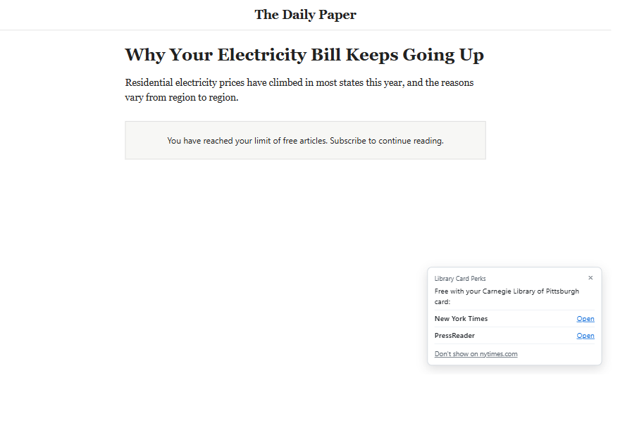
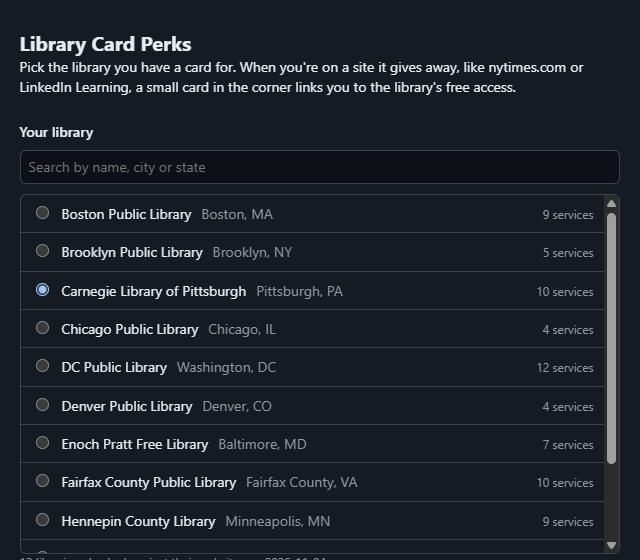

# Library Card Perks

A Chrome extension that reminds you, when you hit a paywall or a paid course, that your library card already gets it for you.



Most big public libraries now pay for things people pay for themselves: New York Times and Wall Street Journal access, Consumer Reports, LinkedIn Learning, Udemy, Kanopy films, language courses, Morningstar. Hardly anyone knows. [Library Extension](https://chromewebstore.google.com/detail/library-extension/chkgcmmjoejpekoegkedcpifgfhpjmec) does this for books and has 90,000 users; nothing did it for the rest.

## How it works

Pick your library once. Then, on a site your library gives away, a small card in the corner links to the library's own way in, usually a sign-in with your card number:

| On | It points to |
|---|---|
| nytimes.com, wsj.com, washingtonpost.com | the library's access to that paper, and PressReader |
| consumerreports.org | Consumer Reports |
| LinkedIn Learning, Udemy, Coursera | LinkedIn Learning, Udemy, Coursera |
| Rosetta Stone, Babbel | Mango Languages |
| Ancestry | Ancestry Library Edition |
| Morningstar, Value Line | Morningstar Investment Research Center, Value Line |
| Chegg | live homework help (Tutor.com, Brainfuse) |
| Prime Video and Apple TV movie pages | Kanopy, hoopla |

The card shows at most once a day per site and can be turned off for a site. The toolbar badge and the popup show what's free on the current site, and the popup lists everything your card gets you.



## The libraries

Twelve so far: Boston, Brooklyn, Carnegie Library of Pittsburgh, Chicago, DC, Denver, Enoch Pratt (Baltimore), Fairfax County, Hennepin County (Minneapolis), Los Angeles, San Francisco and Seattle. If yours isn't listed, the settings page takes the links by hand.

The list isn't typed in. `npm run data` reads each library's public list of online resources (Springshare LibGuides A-Z lists through their JSON endpoint, other sites from the page itself) and records which services it has and the library's own link for each. Archive products with the same name ("New York Times Historical", "WSJ Digital Microfilm") don't count, and a bare link to a vendor's home page is replaced with the library's list, which explains how to get in. A weekly GitHub workflow reruns it.

Adding a library is one line in `scripts/libraries.json`.

Everything runs locally. There's no server, it never sees your card number, and the only permission is `storage`.

## Install

Not on the Chrome Web Store yet. To load it:

1. Clone this repo.
2. Open `chrome://extensions` and turn on Developer mode.
3. Click **Load unpacked** and pick the repo folder.

## Development

```bash
npm test              # unit tests (Node 20+, no dependencies)
npm run e2e           # loads the extension into headless Chrome against stand-in pages
npm run data          # re-reads every library's list into data/libraries.json
```

`npm run e2e -- --screenshots docs` regenerates the screenshots above.

## Not covered yet

- More libraries. New York Public Library and the Free Library of Philadelphia build their lists with scripts or block automated reads, so they need another way in.
- Magazines through Libby and PressReader, title by title.
- Some libraries give 24 to 72-hour passes that need renewing. A renewal reminder would help.

## License

MIT
